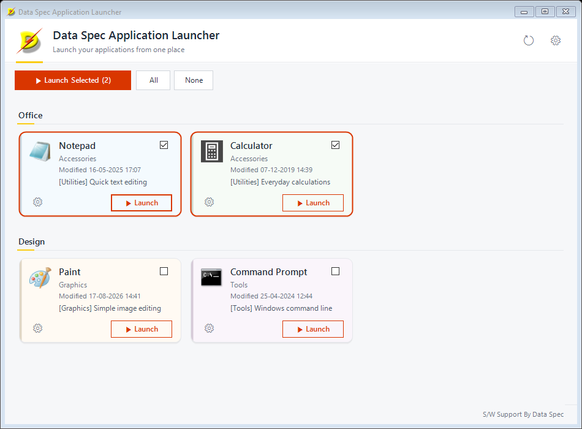

  

<h1 align="center">dsAppLaunch</h1>

<em>Application Launcher by Data Spec</em>

A small Windows utility that shows all your everyday applications as a grid
of cards — and launches them with one click, or several at once.

Add your programs (or drag and drop them in), group them under headings,
choose the order and the card colours, tick the ones you always start
together, and press **Launch Selected**. Programs on network shares are
supported: the window opens instantly and each card fills in its icon and
file date in the background, so an unreachable server never freezes the
launcher.

## Features

- A clean, modern card grid with icon, name, sub group, file date, category
  and description
- Groups with headings, plus a per-app **Sort Order** within each group
- **Launch Selected** — tick cards and start them one after another, in
  on-screen order, with a single summary of anything that could not start
- Built-in settings dialog: add, remove and edit entries, pick files with
  Browse, or drag and drop files onto the list
- Colour-code cards with a stripe and soft tint, and use custom icons
  if you like
- Non-blocking startup: file checks and icon loading run in the background
- Plain JSON configuration, stored per user — no database, no services

## Requirements

- Windows 10 (version 1607 or later) or Windows 11, x64
- The installer is self-contained — no separate .NET install needed.
  Building from source instead requires the .NET 10 SDK.

## Getting started

1. Download the latest `dsAppLaunch.msi` from
   [Releases](https://github.com/gajendhir/dsAppLaunch/releases/latest) and
   run it — or build from source (see the
   [Programmer Reference](docs/programmerreference.md#build--run)).
2. Start **Data Spec Application Launcher** from the Start menu or desktop.
3. Click the gear button (⚙) and add your applications.
4. Click **Save & Apply Changes**. Your cards appear on the main screen.

For a full walkthrough written for non-technical users — no coding
knowledge assumed — see the **[User Guide](docs/userguide.md)**.

For architecture, project structure, the configuration file format and
build/installer details, see the
**[Programmer Reference](docs/programmerreference.md)**.

## Configuration

Your list of applications is stored in
`%AppData%\Data Spec\dsAppLaunch\apps.json`. It is created on first run and
can be edited through the settings dialog or by hand. A sample file is
included as [apps.sample.json](apps.sample.json).

## License

MIT — see [LICENSE.txt](LICENSE.txt).

---

  Software by <a href="https://www.dataspec.info">Data Spec</a>

