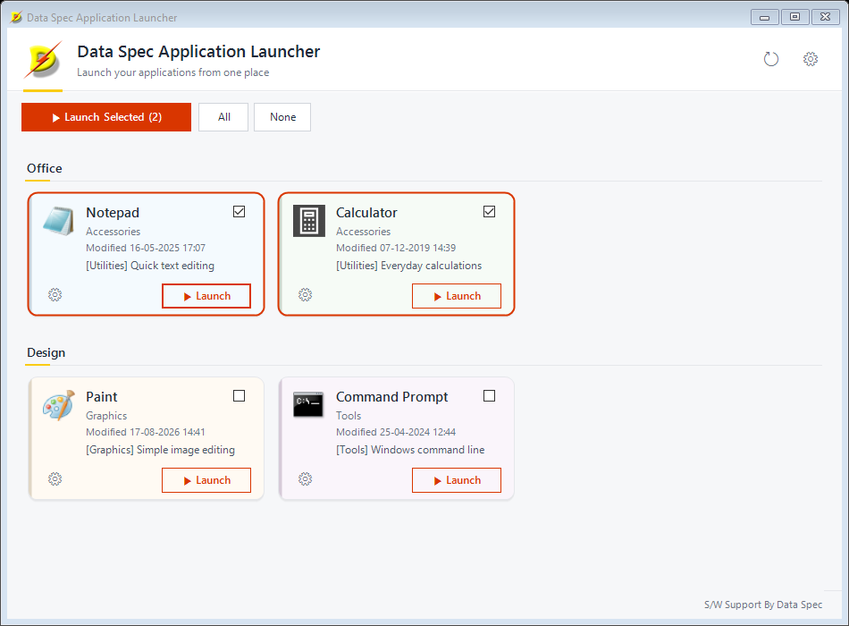
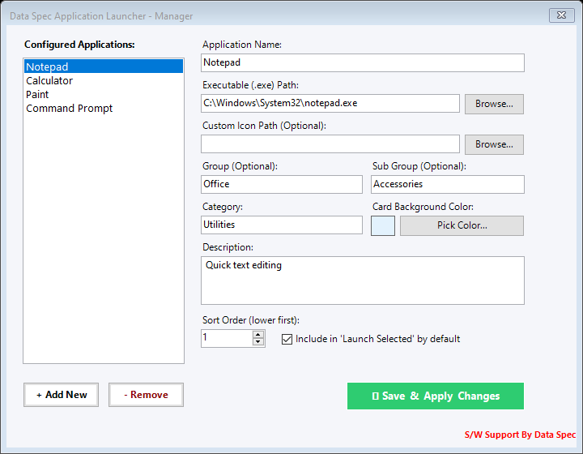

# dsAppLaunch User Guide

This guide walks you through installing and using dsAppLaunch. No technical
or programming knowledge is needed — if you can pick a file in a folder
browser, you can set this up.

## What dsAppLaunch does

dsAppLaunch shows the programs you use every day as a grid of cards. Click
**Launch** on a card to start that program. Tick several cards and click
**Launch Selected** to start them all in one go — handy for the set of
programs you open at the start of every working day.



## Installing

1. Go to the [Releases page](https://github.com/gajendhir/dsAppLaunch/releases/latest)
   and download **dsAppLaunch.msi**.
2. Double-click the file and follow the installer: accept the licence, choose
   the folder (the default is fine), and click **Install**. Windows may ask
   for permission to install — click **Yes**.
3. When it finishes you will find **Data Spec Application Launcher** in your
   Start menu and on your desktop.

To update, simply run a newer `dsAppLaunch.msi` — it replaces the old
version and keeps your list of applications. To remove the program, use
**Settings → Apps** in Windows. Your list of applications is left in place
so it is still there if you reinstall.

## Step 1 — Open Settings

The first time you start dsAppLaunch the screen is empty. Click the **gear
button** (⚙) at the top right of the window to open the **Manager**.

You can also open Manager for one particular program by clicking the small
gear on its card — the Manager opens with that program already selected.

## Step 2 — Add your applications



You can add a program in either of two ways:

- **Drag and drop** — drag a program (an `.exe` file, or a shortcut) from
  Windows Explorer onto the **Configured Applications** list. A new entry is
  created for each file you drop.
- **Add New** — click **+ Add New**, then fill in the fields on the right
  and use **Browse...** to find the program.

For each entry you can set:

| Field | What it is for |
|---|---|
| **Application Name** | The title shown on the card |
| **Executable (.exe) Path** | The program to start. Click **Browse...**, or drop a file onto the box |
| **Custom Icon Path** | Optional. A picture or icon to show instead of the program's own icon |
| **Group** | Optional. Cards with the same group appear together under one heading (for example *Office* or *Accounts*) |
| **Sub Group** | Optional. A second label shown on the card (for example a year or a branch) |
| **Category** | A short label such as *Utilities* |
| **Card Background Color** | Click **Pick Color...** to colour-code the card. The colour appears as a stripe down the card's left edge and a soft tint. Leave it white for a plain card |
| **Description** | A short note shown on the card |
| **Sort Order (lower first)** | Position of the card within its group. 1 comes before 2, and so on |
| **Include in 'Launch Selected' by default** | Tick this for programs that should be ticked every time you open the launcher |

To delete a program from the list, select it and click **- Remove**.

When you are done, click **Save & Apply Changes**. The Manager closes and
your cards appear on the main screen.

## Step 3 — Launch programs

- **One program:** click **▶ Launch** on its card. The card shows a short
  "starting" state while Windows opens the program.
- **Several programs:** tick the box at the top right of each card you want,
  then click the green **▶ Launch Selected (n)** button — the number is how many cards are
  ticked. The programs start one after another, about a second apart, in the
  order they appear on screen.
  - **All** ticks every card and **None** clears every tick.
  - A ticked card gets an orange outline.
  - Ticks are for the current session. Click the **reload button** (the
    circular arrow next to the gear), or save in
    Manager, and the ticks go back to whatever you set with *Include in
    'Launch Selected' by default*.
- If a program cannot be started — for example the file was moved, or a
  network drive is not connected — you get a single message at the end
  listing only the ones that failed. The others still start.

## What is on a card

- The program's icon, its name, and the sub group
- The date and time the program file was last changed, in the bottom row
  (hover for the full text). Double-click it to open the folder that contains the program.
- The category and description (hover to read it in full if it is cut short)
- A tick box, a **Launch** button and a small gear button for that program

Cards for programs on a network share appear straight away; their icon and
date fill in a moment later. If the network drive is switched off, the card
simply stays plain — the rest of the launcher keeps working.

## Where your settings are stored

Your list of programs is saved in the file:

```
%AppData%\Data Spec\dsAppLaunch\apps.json
```

To open it, press **Windows key + R**, paste the line above, and press Enter.
You do not need to edit this file by hand, but you can copy it to keep a
backup, or copy it to another computer to bring your list with you. (Paths
that point to network drives will work on any computer that can reach the
same drives.)

## Troubleshooting

| Problem | What to do |
|---|---|
| A card says the program was not found | The program file was moved or deleted, or the network drive is not connected. Open Manager, select the program and check the **Executable Path** |
| The Manager will not open and shows an error about `apps.json` | The configuration file has been damaged, usually by a manual edit. Fix the text it mentions, or delete the file — you can then add your programs again |
| My cards do not show an icon or a date | The program's file cannot be reached (yet). Wait a few seconds, or click the reload button |
| I changed something outside the launcher and it is not showing | Click the reload button to reload |

## Getting help

Software by [Data Spec](https://www.dataspec.info).
